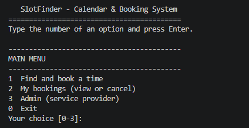
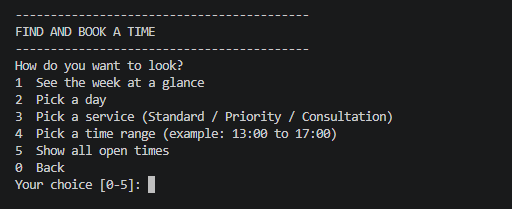
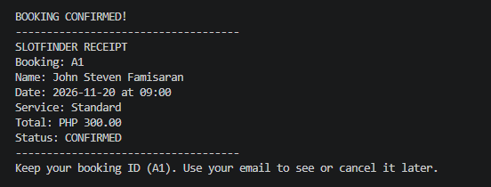
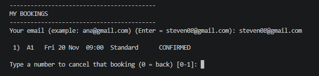
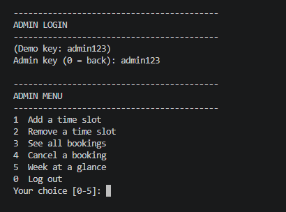

# SlotFinder: Simple Calendar & Booking System (Console Based)

**Object-Oriented Programming | Group 10 | BSIT 2109**

## 1. Project Title

**SlotFinder: Simple Calendar & Booking System**

## 2. Project Description

SlotFinder is a console (text-menu) Java application for opening, viewing, booking and cancelling time slots. A service provider lists the times they are available, and clients choose an open time and book it. Each slot can only be booked once, so two people can never hold the same time. Every question in the program repeats until a valid answer is given, so a typing mistake never crashes it.

## 3. Problem Being Addressed

Manual appointment scheduling often causes accidental double-bookings, miscommunication between clients and service providers, poor schedule visibility and delayed confirmations. There is no simple, error-free system for opening, viewing, reserving and managing time-bound service slots without scheduling conflicts. This affects small business managers, tutors, freelancers, service providers and their clients.

## 4. Project Objectives

**General objective:** To develop a functional, robust Java-based application that automates time-slot management, calendar scheduling and appointment bookings using core Object-Oriented Programming principles.

**Specific objectives:**
- Implement interactive slot creation, listing, reservation and cancellation workflows.
- Incorporate automated conflict-detection logic that prevents double-booking of any time slot.
- Validate all user date and time inputs and handle operational exceptions gracefully.
- Demonstrate the four core OOP principles (Abstraction, Encapsulation, Inheritance, Polymorphism) in the software architecture.

## 5. Target Users

| Target user | How they use the system |
|---|---|
| Administrator / Service Provider | Adds and removes time slots, reviews all bookings, and cancels bookings when necessary |
| Client / Customer | Browses and filters open times, books a time, and views or cancels their own bookings |

## 6. Main Features

| Feature | Description |
|---|---|
| Week at a glance | A calendar table of dates and times showing which slots are open or full |
| Find and book a time | Browse by day, service, time range, or all open times, then book by typing a number and entering a name and email. A receipt is shown after booking |
| Conflict detection | A booked slot cannot be booked again, and two slots cannot share the same date and time |
| Service types and pricing | Standard, Priority and Consultation slots. Priority slots add a priority fee to the base price |
| My bookings | Clients enter their email to see their bookings and cancel one. A cancelled slot opens again |
| Admin tools | Add slots, remove slots, see all bookings and cancel bookings, protected by an admin key |
| Input validation | Checks the date (YYYY-MM-DD), time (HH:mm), email format and prices, and asks again if they are wrong |

## 7. Technologies Used

- **Java 17 or newer** (JDK), with no external libraries or build tools
- **Visual Studio Code** with the Extension Pack for Java
- **GitHub**, with GitHub Actions (compile check) and Codespaces

## 8. Team Members and Roles

| Member | SR-Code | Role |
|---|---|---|
| Advincula, Vreanna | 25-01149 | Documentation |
| Anonuevo, Kian Zyrel | 25-07195 | Lead Programmer |
| Banaag, Rainier M. | 25-01377 | Project Leader |
| Famisaran, John Steven | 25-08908 | System / Design Lead |

## 9. OOP Concepts Demonstrated

| Concept | Where it is used |
|---|---|
| Classes and objects | `User`, `Client`, `Admin`, `Slot`, `StandardSlot`, `VipSlot`, `Appointment`, `BookingService` |
| Methods | `bookSlot()`, `cancelBooking()`, `reserve()`, `release()`, `calculatePrice()`, `validateDate()`, `validateTime()`, `search()` |
| Encapsulation | Private or protected fields with validating setters (`User.setEmail()`, `Slot.setBasePrice()`) |
| Inheritance | `Client` and `Admin` extend `User`. `StandardSlot` and `VipSlot` extend `Slot` |
| Polymorphism | `calculatePrice()` and `getType()` are overridden by each slot type. `displayProfile()` is overridden by each user type |
| Abstraction | `Schedulable` interface, abstract `BookingEntity`, abstract `User` and `Slot` |
| Exception handling | `SlotUnavailableException`, `InvalidTimeFormatException`, `BookingNotFoundException`, caught and shown as friendly messages |
| Collections | `ArrayList<Slot>` and `ArrayList<Appointment>` in `BookingService`, `ArrayList<Appointment>` in `Client` |

## 10. Instructions for Running the Program

**Requirement:** JDK 17 or newer. Check with `javac -version`.

**In Visual Studio Code**
1. Choose **File > Open Folder** and select this project folder.
2. Open `Main.java`.
3. Click the **Run (play) button** at the top right. The program starts in the terminal at the bottom.
4. Click in that terminal, type a number and press Enter.

**From a terminal** (inside the project folder)
- Windows: `.\run.bat`
- Mac / Linux: `bash run.sh`
- Or run: `javac Main.java` and then `java Main`

**On GitHub:** choose **Code > Codespaces > Create codespace on main**. The program starts in the Codespace terminal.

**Using the program**
- Type the number of an option and press Enter. Type `0` to go back.
- *Client:* choose 1 to find and book a time, or 2 to view or cancel your bookings.
- *Admin:* choose 3 and enter the key `admin123`.

## 11. Sample Screenshots

| Screen | Screenshot |
|---|---|
| Main menu |  |
| Week at a glance |  |
| Booking confirmation |  |
| My bookings |  |
| Admin menu |  |

## 12. Known Limitations

- **No database.** Data is stored in memory (`ArrayList`) and resets to the sample slots when the program closes. Nothing is saved to a file.
- **No payment gateway.** Prices and receipts are simulated inside the program.
- **Single timezone.** All dates and times use the local system timezone.
- **Basic admin security.** The admin key is a fixed value in the code, and there are no user accounts or passwords.
- **Exact-match conflicts only.** Two slots cannot share the same date and time, but slots have no length, so overlapping time ranges are not detected.

## 13. Future Improvements

- Save slots and bookings to a file or database so data is kept between runs
- Add slot duration and detect overlapping time ranges
- User accounts with passwords and a secure admin login
- A graphical or web interface
- Email or SMS confirmations and reminders
- Editing existing slots and rescheduling bookings
- Real payment integration and printable invoices

## 14. Project Contributors

| Name | GitHub |
|---|---|
| Advincula, Vreanna | [@vreanna1008](https://github.com/vreanna1008) |
| Anonuevo, Kian Zyrel | [@kianzyrel23](https://github.com/kianzyrel23) |
| Banaag, Rainier M. | [@rainrain](https://github.com/rainrain) |
| Famisaran, John Steven | [@John-Steven08](https://github.com/John-Steven08) |
